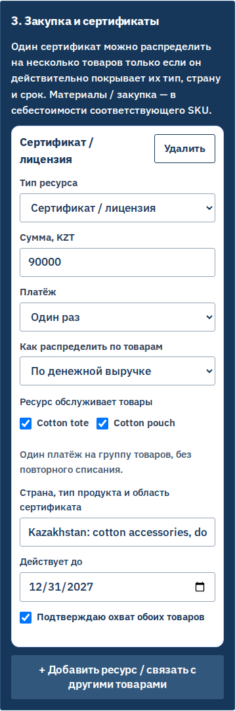
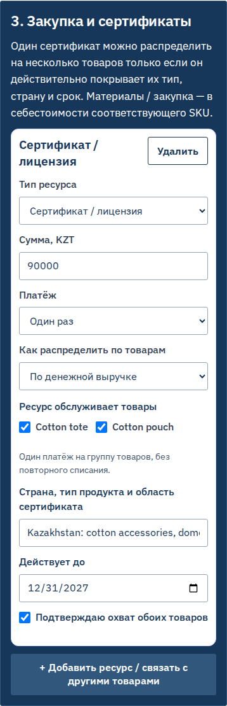
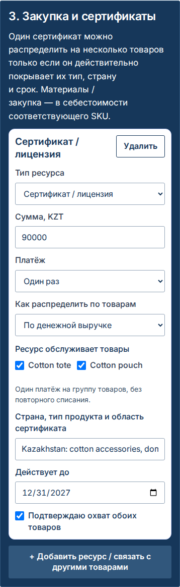
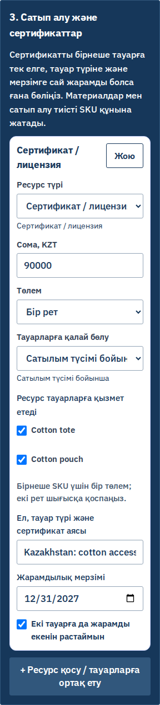
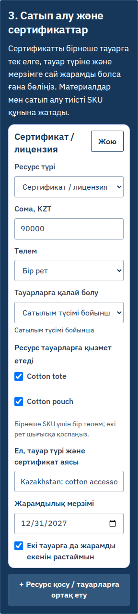
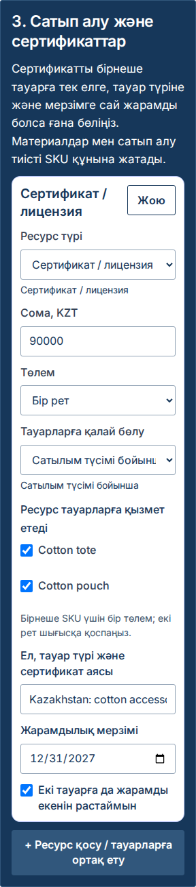
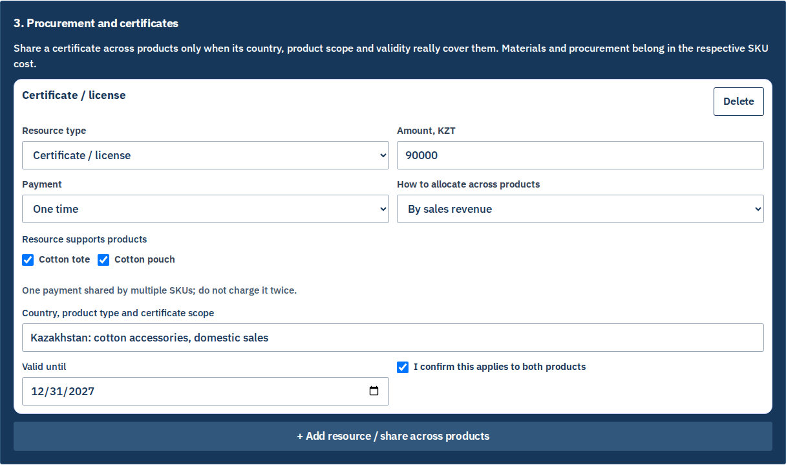
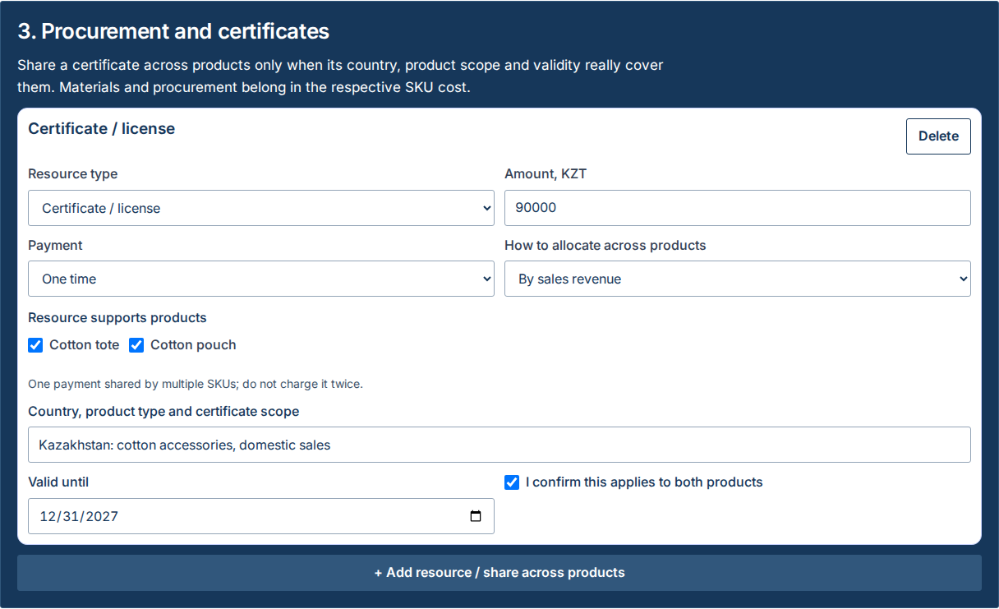

# TYPE-02 A — оригинальные снимки

Один экран, одни исходные значения. Слева исходный main `b1cc9b50`, затем исправленный IBM Plex Sans и Inter. Во всех вариантах форма и финансовые значения настоящие; никакие изображения не генерировались искусственно.

## RU, 390 px

| До | IBM Plex Sans | Inter |
| --- | --- | --- |
|  |  |  |

## KK, 320 px

| До | IBM Plex Sans | Inter |
| --- | --- | --- |
|  |  |  |

## EN, 1280 px

| До | IBM Plex Sans | Inter |
| --- | --- | --- |
|  |  |  |

## Полная матрица

| Язык / ширина | До | Plex | Inter | Ошибка: до / Plex / Inter |
| --- | --- | --- | --- | --- |
| RU / 320 | [PNG](images/ru-320-before-valid.png) | [PNG](images/ru-320-plex-valid.png) | [PNG](images/ru-320-inter-valid.png) | [before](images/ru-320-before-coverage-error.png) / [plex](images/ru-320-plex-coverage-error.png) / [inter](images/ru-320-inter-coverage-error.png) |
| RU / 390 | [PNG](images/ru-390-before-valid.png) | [PNG](images/ru-390-plex-valid.png) | [PNG](images/ru-390-inter-valid.png) | [before](images/ru-390-before-coverage-error.png) / [plex](images/ru-390-plex-coverage-error.png) / [inter](images/ru-390-inter-coverage-error.png) |
| RU / 768 | [PNG](images/ru-768-before-valid.png) | [PNG](images/ru-768-plex-valid.png) | [PNG](images/ru-768-inter-valid.png) | [before](images/ru-768-before-coverage-error.png) / [plex](images/ru-768-plex-coverage-error.png) / [inter](images/ru-768-inter-coverage-error.png) |
| RU / 1280 | [PNG](images/ru-1280-before-valid.png) | [PNG](images/ru-1280-plex-valid.png) | [PNG](images/ru-1280-inter-valid.png) | [before](images/ru-1280-before-coverage-error.png) / [plex](images/ru-1280-plex-coverage-error.png) / [inter](images/ru-1280-inter-coverage-error.png) |
| EN / 320 | [PNG](images/en-320-before-valid.png) | [PNG](images/en-320-plex-valid.png) | [PNG](images/en-320-inter-valid.png) | [before](images/en-320-before-coverage-error.png) / [plex](images/en-320-plex-coverage-error.png) / [inter](images/en-320-inter-coverage-error.png) |
| EN / 390 | [PNG](images/en-390-before-valid.png) | [PNG](images/en-390-plex-valid.png) | [PNG](images/en-390-inter-valid.png) | [before](images/en-390-before-coverage-error.png) / [plex](images/en-390-plex-coverage-error.png) / [inter](images/en-390-inter-coverage-error.png) |
| EN / 768 | [PNG](images/en-768-before-valid.png) | [PNG](images/en-768-plex-valid.png) | [PNG](images/en-768-inter-valid.png) | [before](images/en-768-before-coverage-error.png) / [plex](images/en-768-plex-coverage-error.png) / [inter](images/en-768-inter-coverage-error.png) |
| EN / 1280 | [PNG](images/en-1280-before-valid.png) | [PNG](images/en-1280-plex-valid.png) | [PNG](images/en-1280-inter-valid.png) | [before](images/en-1280-before-coverage-error.png) / [plex](images/en-1280-plex-coverage-error.png) / [inter](images/en-1280-inter-coverage-error.png) |
| KK / 320 | [PNG](images/kk-320-before-valid.png) | [PNG](images/kk-320-plex-valid.png) | [PNG](images/kk-320-inter-valid.png) | [before](images/kk-320-before-coverage-error.png) / [plex](images/kk-320-plex-coverage-error.png) / [inter](images/kk-320-inter-coverage-error.png) |
| KK / 390 | [PNG](images/kk-390-before-valid.png) | [PNG](images/kk-390-plex-valid.png) | [PNG](images/kk-390-inter-valid.png) | [before](images/kk-390-before-coverage-error.png) / [plex](images/kk-390-plex-coverage-error.png) / [inter](images/kk-390-inter-coverage-error.png) |
| KK / 768 | [PNG](images/kk-768-before-valid.png) | [PNG](images/kk-768-plex-valid.png) | [PNG](images/kk-768-inter-valid.png) | [before](images/kk-768-before-coverage-error.png) / [plex](images/kk-768-plex-coverage-error.png) / [inter](images/kk-768-inter-coverage-error.png) |
| KK / 1280 | [PNG](images/kk-1280-before-valid.png) | [PNG](images/kk-1280-plex-valid.png) | [PNG](images/kk-1280-inter-valid.png) | [before](images/kk-1280-before-coverage-error.png) / [plex](images/kk-1280-plex-coverage-error.png) / [inter](images/kk-1280-inter-coverage-error.png) |

## Reflow и динамические поля

| Язык | 200%: Plex / Inter | Восстановлено с распределением по загрузке: Plex / Inter |
| --- | --- | --- |
| RU | [plex](images/ru-1280-plex-zoom200.png) / [inter](images/ru-1280-inter-zoom200.png) | [plex](images/ru-390-plex-usage-restored.png) / [inter](images/ru-390-inter-usage-restored.png) |
| EN | [plex](images/en-1280-plex-zoom200.png) / [inter](images/en-1280-inter-zoom200.png) | [plex](images/en-390-plex-usage-restored.png) / [inter](images/en-390-inter-usage-restored.png) |
| KK | [plex](images/kk-1280-plex-zoom200.png) / [inter](images/kk-1280-inter-zoom200.png) | [plex](images/kk-390-plex-usage-restored.png) / [inter](images/kk-390-inter-usage-restored.png) |

200% проверено эквивалентной desktop-геометрией 1280 физических px / 640 CSS px / DPR 2. Ручной browser zoom остаётся частью визуальной приёмки. Все 84 оригинала сохранены без перекраски, склейки или изменения размеров.

В EN/KK состояние ошибки включает прежнюю непереведённую строку из исходного main. Это отмечено в [отчёте](../type02-reference-review.md), сохранено на снимках и не скрыто результатами проверки типографики.
