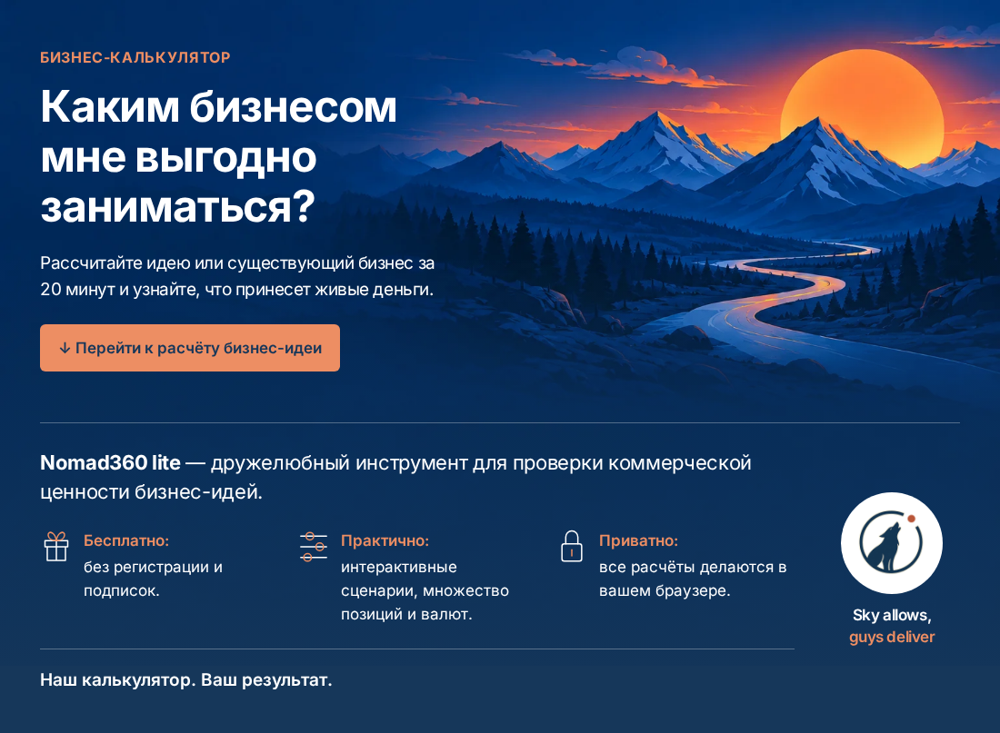
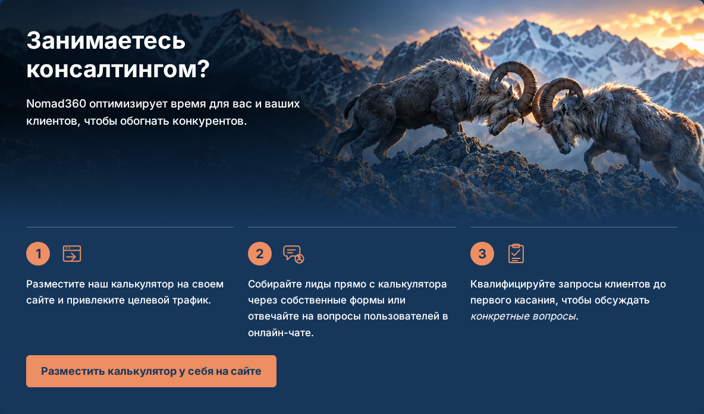

# Баннеры — доработка после отказа

Текущие снимки Chromium относятся к реализации `940f59d`. Предыдущие версии не приняты владельцем. Новая версия также ожидает визуальной приёмки.

Последние указания учтены: у главного баннера нет отдельной синей подложки под текстом; фон картинки плавно переходит в фирменный синий. В широком B2B усилено затемнение под текстом, подзаголовок ограничен своей колонкой.

Быстрый просмотр:

- Главный: [desktop 1280](revision-2/ru-1280-nomad360-commercial-banner-closed.png) · [mobile 390](revision-2/ru-390-nomad360-commercial-banner-closed.png) · [mobile 320](revision-2/ru-320-nomad360-commercial-banner-closed.png).
- Бараны: [desktop 1280](revision-2/ru-1280-nomad360-embed-closed.png) · [mobile 390](revision-2/ru-390-nomad360-embed-closed.png).

| Язык / ширина | Главный | О проекте | Поддержка | Документы | B2B |
| --- | --- | --- | --- | --- | --- |
| RU / 320 | [снимок](revision-2/ru-320-nomad360-commercial-banner-closed.png) | [снимок](revision-2/ru-320-nomad360-information-closed.png) | [снимок](revision-2/ru-320-nomad360-return-support-closed.png) | [снимок](revision-2/ru-320-nomad360-legal-strip-closed.png) | [снимок](revision-2/ru-320-nomad360-embed-closed.png) |
| RU / 360 | [снимок](revision-2/ru-360-nomad360-commercial-banner-closed.png) | [снимок](revision-2/ru-360-nomad360-information-closed.png) | [снимок](revision-2/ru-360-nomad360-return-support-closed.png) | [снимок](revision-2/ru-360-nomad360-legal-strip-closed.png) | [снимок](revision-2/ru-360-nomad360-embed-closed.png) |
| RU / 390 | [снимок](revision-2/ru-390-nomad360-commercial-banner-closed.png) | [снимок](revision-2/ru-390-nomad360-information-closed.png) | [снимок](revision-2/ru-390-nomad360-return-support-closed.png) | [снимок](revision-2/ru-390-nomad360-legal-strip-closed.png) | [снимок](revision-2/ru-390-nomad360-embed-closed.png) |
| RU / 430 | [снимок](revision-2/ru-430-nomad360-commercial-banner-closed.png) | [снимок](revision-2/ru-430-nomad360-information-closed.png) | [снимок](revision-2/ru-430-nomad360-return-support-closed.png) | [снимок](revision-2/ru-430-nomad360-legal-strip-closed.png) | [снимок](revision-2/ru-430-nomad360-embed-closed.png) |
| RU / 768 | [снимок](revision-2/ru-768-nomad360-commercial-banner-closed.png) | [снимок](revision-2/ru-768-nomad360-information-closed.png) | [снимок](revision-2/ru-768-nomad360-return-support-closed.png) | [снимок](revision-2/ru-768-nomad360-legal-strip-closed.png) | [снимок](revision-2/ru-768-nomad360-embed-closed.png) |
| RU / 1280 | [снимок](revision-2/ru-1280-nomad360-commercial-banner-closed.png) | [снимок](revision-2/ru-1280-nomad360-information-closed.png) | [снимок](revision-2/ru-1280-nomad360-return-support-closed.png) | [снимок](revision-2/ru-1280-nomad360-legal-strip-closed.png) | [снимок](revision-2/ru-1280-nomad360-embed-closed.png) |
| RU / 1440 | [снимок](revision-2/ru-1440-nomad360-commercial-banner-closed.png) | [снимок](revision-2/ru-1440-nomad360-information-closed.png) | [снимок](revision-2/ru-1440-nomad360-return-support-closed.png) | [снимок](revision-2/ru-1440-nomad360-legal-strip-closed.png) | [снимок](revision-2/ru-1440-nomad360-embed-closed.png) |
| EN / 320 | [снимок](revision-2/en-320-nomad360-commercial-banner-closed.png) | [снимок](revision-2/en-320-nomad360-information-closed.png) | [снимок](revision-2/en-320-nomad360-return-support-closed.png) | [снимок](revision-2/en-320-nomad360-legal-strip-closed.png) | [снимок](revision-2/en-320-nomad360-embed-closed.png) |
| EN / 360 | [снимок](revision-2/en-360-nomad360-commercial-banner-closed.png) | [снимок](revision-2/en-360-nomad360-information-closed.png) | [снимок](revision-2/en-360-nomad360-return-support-closed.png) | [снимок](revision-2/en-360-nomad360-legal-strip-closed.png) | [снимок](revision-2/en-360-nomad360-embed-closed.png) |
| EN / 390 | [снимок](revision-2/en-390-nomad360-commercial-banner-closed.png) | [снимок](revision-2/en-390-nomad360-information-closed.png) | [снимок](revision-2/en-390-nomad360-return-support-closed.png) | [снимок](revision-2/en-390-nomad360-legal-strip-closed.png) | [снимок](revision-2/en-390-nomad360-embed-closed.png) |
| EN / 430 | [снимок](revision-2/en-430-nomad360-commercial-banner-closed.png) | [снимок](revision-2/en-430-nomad360-information-closed.png) | [снимок](revision-2/en-430-nomad360-return-support-closed.png) | [снимок](revision-2/en-430-nomad360-legal-strip-closed.png) | [снимок](revision-2/en-430-nomad360-embed-closed.png) |
| EN / 768 | [снимок](revision-2/en-768-nomad360-commercial-banner-closed.png) | [снимок](revision-2/en-768-nomad360-information-closed.png) | [снимок](revision-2/en-768-nomad360-return-support-closed.png) | [снимок](revision-2/en-768-nomad360-legal-strip-closed.png) | [снимок](revision-2/en-768-nomad360-embed-closed.png) |
| EN / 1280 | [снимок](revision-2/en-1280-nomad360-commercial-banner-closed.png) | [снимок](revision-2/en-1280-nomad360-information-closed.png) | [снимок](revision-2/en-1280-nomad360-return-support-closed.png) | [снимок](revision-2/en-1280-nomad360-legal-strip-closed.png) | [снимок](revision-2/en-1280-nomad360-embed-closed.png) |
| EN / 1440 | [снимок](revision-2/en-1440-nomad360-commercial-banner-closed.png) | [снимок](revision-2/en-1440-nomad360-information-closed.png) | [снимок](revision-2/en-1440-nomad360-return-support-closed.png) | [снимок](revision-2/en-1440-nomad360-legal-strip-closed.png) | [снимок](revision-2/en-1440-nomad360-embed-closed.png) |
| KK / 320 | [снимок](revision-2/kk-320-nomad360-commercial-banner-closed.png) | [снимок](revision-2/kk-320-nomad360-information-closed.png) | [снимок](revision-2/kk-320-nomad360-return-support-closed.png) | [снимок](revision-2/kk-320-nomad360-legal-strip-closed.png) | [снимок](revision-2/kk-320-nomad360-embed-closed.png) |
| KK / 360 | [снимок](revision-2/kk-360-nomad360-commercial-banner-closed.png) | [снимок](revision-2/kk-360-nomad360-information-closed.png) | [снимок](revision-2/kk-360-nomad360-return-support-closed.png) | [снимок](revision-2/kk-360-nomad360-legal-strip-closed.png) | [снимок](revision-2/kk-360-nomad360-embed-closed.png) |
| KK / 390 | [снимок](revision-2/kk-390-nomad360-commercial-banner-closed.png) | [снимок](revision-2/kk-390-nomad360-information-closed.png) | [снимок](revision-2/kk-390-nomad360-return-support-closed.png) | [снимок](revision-2/kk-390-nomad360-legal-strip-closed.png) | [снимок](revision-2/kk-390-nomad360-embed-closed.png) |
| KK / 430 | [снимок](revision-2/kk-430-nomad360-commercial-banner-closed.png) | [снимок](revision-2/kk-430-nomad360-information-closed.png) | [снимок](revision-2/kk-430-nomad360-return-support-closed.png) | [снимок](revision-2/kk-430-nomad360-legal-strip-closed.png) | [снимок](revision-2/kk-430-nomad360-embed-closed.png) |
| KK / 768 | [снимок](revision-2/kk-768-nomad360-commercial-banner-closed.png) | [снимок](revision-2/kk-768-nomad360-information-closed.png) | [снимок](revision-2/kk-768-nomad360-return-support-closed.png) | [снимок](revision-2/kk-768-nomad360-legal-strip-closed.png) | [снимок](revision-2/kk-768-nomad360-embed-closed.png) |
| KK / 1280 | [снимок](revision-2/kk-1280-nomad360-commercial-banner-closed.png) | [снимок](revision-2/kk-1280-nomad360-information-closed.png) | [снимок](revision-2/kk-1280-nomad360-return-support-closed.png) | [снимок](revision-2/kk-1280-nomad360-legal-strip-closed.png) | [снимок](revision-2/kk-1280-nomad360-embed-closed.png) |
| KK / 1440 | [снимок](revision-2/kk-1440-nomad360-commercial-banner-closed.png) | [снимок](revision-2/kk-1440-nomad360-information-closed.png) | [снимок](revision-2/kk-1440-nomad360-return-support-closed.png) | [снимок](revision-2/kk-1440-nomad360-legal-strip-closed.png) | [снимок](revision-2/kk-1440-nomad360-embed-closed.png) |

[Все новые снимки и JSON-протоколы](revision-2/) включают раскрытия платежей, документов, B2B и справки ярлыков.

[Исходный живой сайт](baseline/live/) · [исходный локальный main](baseline/local/) · [отклонённая версия 94c1aa6c](REJECTED_94c1aa6c_SCREENSHOTS.md).

