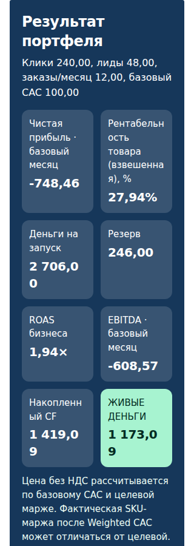
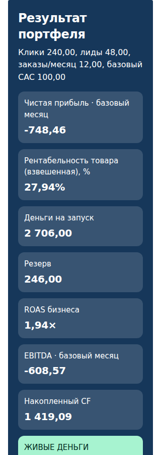
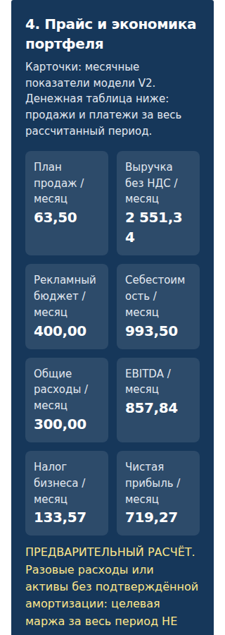
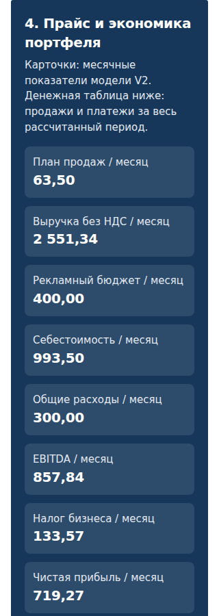

# PR #130 — исправление разрыва денежных сумм

Этап 2 повторно представлен для приёмки. PR остаётся черновиком; main и рабочий
сайт не изменены. Этап 3 не начат.

Первоначальные зелёные проверки не проверяли число строк финансовых значений.
На 320 px унаследованный `overflow-wrap:anywhere` разрывал десятичную часть.
[Первоначальный REVIEW.md с доступными ссылками](v2-stage2-review-original.md)
опубликован отдельно как исторический документ отклонённой версии `3df23f55`.

## Что исправлено

Числовые значения месячных итогов, стартового капитала и итогов периода получили
отдельный класс с `white-space:nowrap`, `overflow-wrap:normal` и
`word-break:normal`. Длинные подписи сохраняют переносы. На телефонах финансовые
карточки занимают одну колонку; на широких экранах остаётся несколько колонок.
Шрифт и формат чисел не уменьшены и не изменены. Порядок показателей сохранён.

Изменены только CSS и class-атрибуты существующих шаблонов в
[nomad360_design_system.css](../../nomad360_design_system.css),
[portfolio_v2_ui.js](../../portfolio_v2_ui.js) и
[portfolio_v2_linked_ui.js](../../portfolio_v2_linked_ui.js).
Формулы, движки, поля ввода, события и схема черновиков не менялись.

## Проверки

Проверенная реализация: `5e5f29acb6b715f585aa8849562558ea2e176aed`.
[CI-прогон](https://github.com/KazartsevEV/shelter-partner-directory/actions/runs/38246859620):
все 8 проверок успешны.

- Общая матрица: 162 сценария до и 162 после, обе ветки RU/EN/KK на
  320/360/390/430/768/1280 px. Финансовые результаты и черновики совпали 162/162.
  Новый контроль строк чисел включён в эту матрицу; нарушений нет.
- Отдельный Chromium-тест: 36 сценариев отклонённой версии и 36 исправленной.
  Проверены 522 фактических числовых значения в исправленной версии.
  Нарушений одной строки или видимости значения внутри ячейки нет.
- В тех же сценариях проверены дополнительные отображаемые значения
  `2 706,00`, `1 419,09`, `2 551,34`, `−25 051,34` и `−99 999 999,99`.
  Они не меняют входные данные бизнеса; результат модели до/после таких
  контрольных подстановок сравнивается отдельно. Нарушений нет.
- Отклонённый CSS воспроизводит дефект. На RU/320 самостоятельная ветка
  разрывает `2 706,00`, `1 419,09` и `1 173,09`; связанная — `2 551,34`.
  В исправленной версии все эти значения занимают одну строку и помещаются.
- Текст фактических значений и вычисленные размеры шрифта совпадают между
  отклонённой и исправленной версиями во всех 36 сравнениях.

Тест измеряет прямоугольники **текстовых узлов**, группирует их по строкам и
проверяет границы ячейки и самого значения. Он обнаруживает и разрыв числа,
и выход за границу, включая скрытие/обрезание длинного значения. Наличие CSS-класса
или одиночного DOM-узла не считается доказательством одной строки.

[Тест](../../tests/nomad360_v2_money_lines_browser.test.cjs) ·
[Измерение строк](../../tests/helpers/v2-money-lines.cjs) ·
[Индекс публичных численных протоколов](v2-stage2-money/numeric-receipts.json) ·
[Полный архив теста](https://github.com/KazartsevEV/shelter-partner-directory/actions/runs/38246859620/artifacts/11745724251).

## Сравнение на 320 px

Снимки ниже опубликованы непосредственно в репозитории. Они показывают
реальные результаты исходной модели, без контрольных подстановок чисел.

| Ветка / язык | Отклонённая версия | Исправленная версия |
| --- | --- | --- |
| Самостоятельный RU | [до](v2-stage2-money/rejected-standalone-ru-320-results.png) | [после](v2-stage2-money/fixed-standalone-ru-320-results.png) |
| Самостоятельный EN | [до](v2-stage2-money/rejected-standalone-en-320-results.png) | [после](v2-stage2-money/fixed-standalone-en-320-results.png) |
| Самостоятельный KK | [до](v2-stage2-money/rejected-standalone-kk-320-results.png) | [после](v2-stage2-money/fixed-standalone-kk-320-results.png) |
| Связанный RU | [до](v2-stage2-money/rejected-linked-ru-320-results.png) | [после](v2-stage2-money/fixed-linked-ru-320-results.png) |
| Связанный EN | [до](v2-stage2-money/rejected-linked-en-320-results.png) | [после](v2-stage2-money/fixed-linked-en-320-results.png) |
| Связанный KK | [до](v2-stage2-money/rejected-linked-kk-320-results.png) | [после](v2-stage2-money/fixed-linked-kk-320-results.png) |

### Самостоятельный портфель, RU

| До | После |
| --- | --- |
|  |  |

### Связанный портфель, RU

| До | После |
| --- | --- |
|  |  |

Отдельные кадры нижних денежных итогов:
[самостоятельный до](v2-stage2-money/rejected-standalone-ru-320-capital.png) /
[после](v2-stage2-money/fixed-standalone-ru-320-capital.png);
[связанный до](v2-stage2-money/rejected-linked-ru-320-capital.png) /
[после](v2-stage2-money/fixed-linked-ru-320-capital.png).
Архив также содержит сравнения на 390 и 1280 px.

## Остальной этап 2

Формы сохраняют принятую в PR #130 компоновку: одна колонка на телефонах,
отдельные адаптивные группы на широких экранах, поля от 44 px, чекбоксы 18 px,
перенос длинных названий и полные выбранные значения под нативными списками.
Проверки геометрии форм, контраста, взаимодействий, смены языка/ширины и семь
сценариев без Tailwind продолжают выполняться.

Полная локализация остаётся отдельной задачей: прежние непереведённые подписи
полной услуги не изменены. Системные подписи выбора файла и даты зависят от
языка браузера. Таблицы сохраняют локальную горизонтальную прокрутку.

Этот отчёт описывает исправление числовых карточек; цветовая иерархия CTA,
семантика ресурсов/зарплат и перестановка финансовых показателей относятся
к следующим этапам и здесь не выполнялись.
