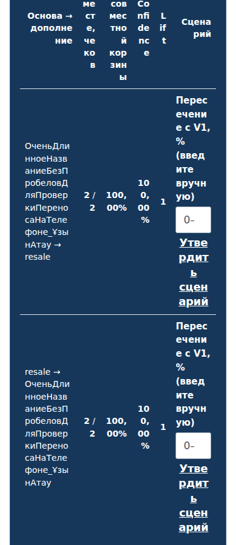
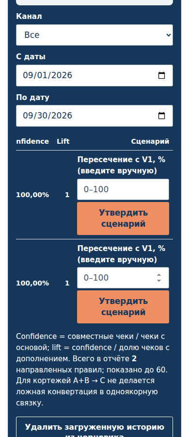
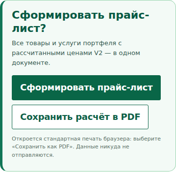
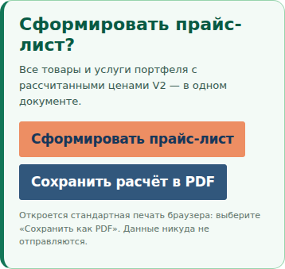

# PR #131 — этап 3: кнопки V2

Этап 3 представлен для приёмки в отдельной ветке от объединённого main
`3de135c1df5444cb065ca9bdbc73b56ae05a9f9d`. PR #129 и PR #130 объединены
последовательно по указанию пользователя. Развёртывание main прошло успешно;
CSS и основные UI-модули в пакете Pages совпали с объединённой версией.
[Развёртывание](https://github.com/KazartsevEV/shelter-partner-directory/actions/runs/38253977754).
Последующее автоматическое обновление статистики репозитория не меняло калькулятор.

Этот PR остаётся черновиком. Этап 3 в main не объединён; этап 4 не начат.

## Изменения

Оранжевый `#ED8E63` с тёмно-синим текстом: сохранение расчёта/портфеля,
утверждение сценария из истории, формирование прайса и сохранение его PDF.
Синий `#31577C` с белым текстом: добавление товаров, ресурсов, предложений,
позиций и экспорт расчёта в PDF. Контурные кнопки: возврат, новый портфель,
удаление, скачивание шаблонов и скрытие прайса. На светлых карточках контур
и текст тёмно-синие, на тёмных — белые.

Область нажатия — от 44 px. Подписи переносятся; hover/active имеют отдельные
оттенки. Фокус обозначен двумя цветами для светлого и тёмного фона.
Неактивные кнопки сохраняют нативный disabled и получили непрозрачный приглушённый
фон. Нативная кнопка выбора файла синяя. Цвет текста не анимируется при появлении
кнопки возврата, поэтому контраст появляется сразу.

В таблице истории кнопка «Утвердить сценарий» теперь имеет минимум 190 px,
а таблица — минимум 900 px внутри прежней области локальной прокрутки.
Слова кнопки и заголовки таблицы читаются целиком. Колонки, порядок и поля
сохранены; на страницу горизонтальная прокрутка не распространяется.
Существующее сообщение об отказе без ручной оценки пересечения стало читаемым
на светлом фоне. Условие утверждения и текст сообщения сохранены.

В четырёх runtime UI-файлах изменены только class-атрибуты существующих шаблонов.
Общие кнопки экспорта оформлены CSS-селекторами внутри V2; модуль экспорта
не менялся. Сохранены подписи, обработчики, навигация, финансовые движки,
формулы, значения полей и формат черновиков. V1, хедер, футер и пожертвования
не изменялись.

## Проверки

Проверенная реализация: `658df93b1a53ac5b7c1b773765355eaea196815a`.
[Chromium-прогон](https://github.com/KazartsevEV/shelter-partner-directory/actions/runs/38260811212).
Все 8 CI-проверок прошли.

| Проверка | Результат |
| --- | --- |
| Сценарии до / после | 162 / 162 |
| Финансовые результаты и черновики | Совпали 162/162 |
| Проверенные кнопки и ссылки-действия | 3 870 |
| Поля ввода / текстовые элементы | 14 796 / 91 985 |
| Минимальный контраст текста всей матрицы | 4,77:1 |
| Минимальный контраст кнопок в обычном состоянии | 5,01:1 |
| Минимальный контраст в hover/active/focus | 4,72:1 |
| Нарушения геометрии / переполнение страницы | 0 / 0 |
| Проверенные числовые значения в основной матрице | 1 980, без разрывов и обрезания |
| Проверки hover/active/focus | 36 |
| Сравнения цепочек действий до / после | Совпали 6/6 |

Проверены самостоятельный и связанный V2, RU/EN/KK,
320/360/390/430/768/1280 px: готовые и незаполненные расчёты, кредит,
дропшиппинг, пять источников V1, история, сопоставление SKU, полная услуга,
сертификаты, склады и комплекты. Семь сценариев прошли без Tailwind.
Сохранены проверки смены языка/ширины и неразрывности финансовых сумм.

Действия проверены мышью и клавишами Enter/Space: сохранение, добавление и
удаление, новый портфель, возврат/восстановление, скачивание CSV/JSON,
загрузка истории, обязательная ручная оценка пересечения, утверждение сценария,
прайс и PDF, неактивная кнопка создания предложения. После каждого действия
данные и финансовый результат сравниваются с объединённым этапом 2.
Для PDF сравниваются HTML печати и вызов `print()`; системный диалог сохранения
не автоматизируется и готовый PDF-файл в этом тесте не сравнивается.

Проверка текста измеряет Range-прямоугольники букв и чисел. Она обнаруживает
разрыв «Утвердить» на фрагменты даже при полном попадании текста в границы
кнопки. Разрешены обычные переносы по пробелам и дефисам («прайс-лист»).
На исходном main тест воспроизводит разрыв подписи в таблице истории;
в исправленной версии фрагментации нет. Произвольные пользовательские названия
в ссылках возврата сохраняют адаптивные переносы.

Отдельный тест сумм: 36 сценариев отклонённого CSS и 36 исправленного,
522 фактических числовых значения и контрольные подстановки длинных отрицательных
сумм. Разрывов и обрезания нет; значения, размер шрифта и финансы сохранены.

[Критерии](../v2-buttons-stage3.md) ·
[Проверка кнопок](../../tests/helpers/v2-buttons.cjs) ·
[Проверка действий](../../tests/nomad360_v2_buttons_browser.test.cjs) ·
[Сводный протокол](v2-stage3-buttons/summary.json).

## Снимки до / после

В репозитории опубликованы 37 исходных PNG без редактирования.
Полные архивы содержат 366 PNG общей матрицы, 33 PNG действий/состояний
и 72 PNG отдельной проверки сумм; остальные ширины имеют численные протоколы.

| Ветка / язык / ширина | До | После |
| --- | --- | --- |
| Самостоятельный RU / 320 | [до](v2-stage3-buttons/before-standalone-ready-ru-320-actions.png) | [после](v2-stage3-buttons/after-standalone-ready-ru-320-actions.png) |
| Связанный RU / 320 | [до](v2-stage3-buttons/before-linked-ready-ru-320-actions.png) | [после](v2-stage3-buttons/after-linked-ready-ru-320-actions.png) |
| Самостоятельный EN / 320 | [до](v2-stage3-buttons/before-standalone-ready-en-320-actions.png) | [после](v2-stage3-buttons/after-standalone-ready-en-320-actions.png) |
| Связанный EN / 320 | [до](v2-stage3-buttons/before-linked-ready-en-320-actions.png) | [после](v2-stage3-buttons/after-linked-ready-en-320-actions.png) |
| Самостоятельный KK / 320 | [до](v2-stage3-buttons/before-standalone-ready-kk-320-actions.png) | [после](v2-stage3-buttons/after-standalone-ready-kk-320-actions.png) |
| Связанный KK / 320 | [до](v2-stage3-buttons/before-linked-ready-kk-320-actions.png) | [после](v2-stage3-buttons/after-linked-ready-kk-320-actions.png) |

Для 1280 px опубликованы такие же пары RU/EN/KK в
[каталоге снимков](v2-stage3-buttons).

| Утверждение сценария: до | После |
| --- | --- |
|  |  |

Снимок после выполнен с прокруткой таблицы к колонке «Сценарий».
Частично видимая слева соседняя колонка находится в той же области прокрутки.

| Действия прайса / PDF: до | После |
| --- | --- |
|  |  |

Дополнительные пары:
[товар до](v2-stage3-buttons/before-standalone-ready-ru-320-sku.png) /
[после](v2-stage3-buttons/after-standalone-ready-ru-320-sku.png),
[ресурс до](v2-stage3-buttons/before-linked-ready-ru-320-resources.png) /
[после](v2-stage3-buttons/after-linked-ready-ru-320-resources.png),
[прайс до](v2-stage3-buttons/before-linked-ru-390-price.png) /
[после](v2-stage3-buttons/after-linked-ru-390-price.png).
[Фокус самостоятельного V2](v2-stage3-buttons/standalone-ru-320-focus.png) ·
[фокус связанного V2](v2-stage3-buttons/linked-ru-320-focus.png) ·
[disabled](v2-stage3-buttons/linked-ru-390-disabled.png).

Полные архивы с JSON:
[самостоятельный V2](https://github.com/KazartsevEV/shelter-partner-directory/actions/runs/38260811212/artifacts/11753365638),
[связанный V2](https://github.com/KazartsevEV/shelter-partner-directory/actions/runs/38260811212/artifacts/11752512450),
[действия/состояния](https://github.com/KazartsevEV/shelter-partner-directory/actions/runs/38260811212/artifacts/11753001219),
[суммы](https://github.com/KazartsevEV/shelter-partner-directory/actions/runs/38260811212/artifacts/11753325886).

Оформление самой панели прайса и финансовых таблиц, семантика ресурсов/зарплат
и полная локализация остаются задачами следующих этапов. Нативные подписи
выбора файла и даты зависят от языка браузера. Новые подписи не вводились.
